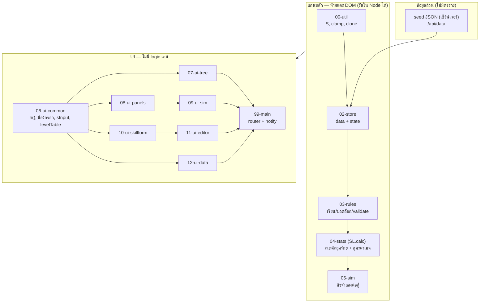
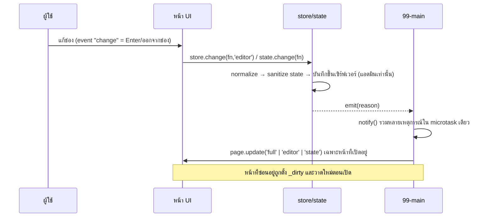

# สถาปัตยกรรมของ RO Skill Lab

เอกสารนี้อธิบาย "แบบแผน" ของ Skill Lab: แบ่งชั้นอย่างไร ข้อมูลไหลอย่างไร และทำไมการเพิ่ม/แก้สกิล คลาส หรือการเชื่อมต่อจึง **ไม่กระทบส่วนอื่น**

## 1. เป้าหมายการออกแบบ (ที่มาจากคำขอ)

> "ทำหน้าต่างไว้จำลองเฉพาะสกิล สามารถเพิ่มสกิล คลาส โครงสร้างได้ในภายหลัง เผื่อแก้ไขปรับปรุงไม่ให้กระทบส่วนอื่น และมีการปรับการเชื่อมต่อสกิลได้ง่าย"

แปลเป็นข้อกำหนดทางวิศวกรรม:

| ข้อกำหนด | วิธีที่ทำ |
|---|---|
| เพิ่มสกิล/คลาส/สาย ได้ภายหลัง | ทุกอย่างเป็น **ข้อมูลล้วน** (JSON) ใน `DEFAULT_DATA` / หน้า "ตัวแก้ไข" / นำเข้า JSON — ไม่มีสกิลใดฝังอยู่ในโค้ด |
| ไม่กระทบส่วนอื่น | แยกโมดูล, แยก data กับ state, UI ไม่มี logic เกม, ทุกการแก้ผ่านจุดเดียว (`store.change`) แล้วแจ้งผู้ฟัง |
| ปรับการเชื่อมต่อสกิลง่าย | การเชื่อมต่อ = อาเรย์ `requires:[{id,lv}]` ในสกิลปลายทาง; กราฟวาดจากข้อมูลทั้งหมด; แก้ได้ทั้งสองฝั่งในตัวแก้ไข; validator จับ cycle |

## 2. ภาพรวมเลเยอร์

## 3. โมดูลและหน้าที่

| ไฟล์ | `SL.*` ที่ export | หน้าที่ | ห้ามทำ |
|---|---|---|---|
| `00-util.js` | `util` | `val(S,lv)`, `lin`, `sMode`, `clone`, `fmt`, `preview`, `slug`, `clamp` | — |
| _(ไม่มีโมดูลข้อมูลในเบราว์เซอร์)_ | — | ข้อมูลเกมทั้งชุดมาจากฐานข้อมูลผ่าน `/api/data` (seed = `server/internal/gamedata/seed/game-data.json`) | ฝังค่าเริ่มต้นในโค้ด |
| `02-store.js` | `store`, `state`, `loadAll` | เก็บ/โหลด/บันทึก data และ state, `normalize`, `sanitize`, import/export | รู้จัก UI |
| `03-rules.js` | `rules` | `chain`, `visibleSkills`, `pointInfo`, `canLearn/Unlearn`, `learn/unlearn`, `applyBuild`, `weaponOk`, `defaultRotation`, `validate` | แตะ DOM |
| `04-stats.js` | `calc` | `player()`, `monster()`, `components()`/`roll()` (ดาเมจ), `monsterStrike()`, `usage()`, ตัวช่วยแสดงผลสเตตัส | มีเวลา/สถานะค้าง (เป็นฟังก์ชันล้วน) |
| `05-sim.js` | `sim` | `create(state)` → ตัวจำลอง (`advance/cast/view/summary/drain`), `benchmark`, `benchBuilds`, `stateFromBuild` | แตะ DOM |
| `06-ui-common.js` | `ui` | `ui.h` (สร้าง DOM), ช่องกรอก, `sInput`, `levelTable`, `skillBrief`, `charPanel`, `toast`, `confirmBtn` | logic เกม |
| `07-ui-tree.js` | `ui.pages.tree` | กราฟ SVG + รายละเอียด + ปุ่มเรียน/ลด | พิกัดฝังตายตัว |
| `08-ui-panels.js` | `ui.panels.*` | ลำดับสกิลอัตโนมัติ, สเตตัสสุดท้าย, ตารางดาเมจ, benchmark | — |
| `09-ui-sim.js` | `ui.pages.sim` | หน้าจำลอง + ลูป `requestAnimationFrame` | — |
| `10-ui-skillform.js` | `ui.skillForm` | ฟอร์มแก้สกิล 1 ตัว (ทุกฟิลด์) | เรียกหน้าอื่นตรง ๆ (ใช้ `api` ที่ส่งมา) |
| `11-ui-editor.js` | `ui.pages.editor` | รายการ + CRUD สกิล/คลาส/สาย, rename พร้อมแก้อ้างอิง | — |
| `12-ui-data.js` | `ui.pages.data` | validator, globals, export/import/merge, แก้ JSON ทีละหมวด, reset | — |
| `99-main.js` | — | โหลดข้อมูล, mount หน้า, router (hash), `notify/flush` | — |

**กฎการพึ่งพา:** โมดูลเลขน้อยกว่าพึ่งกันได้เท่านั้น (ไม่ย้อนขึ้น) · `00–05` ห้ามแตะ `document`/`window` (ทดสอบด้วย Node ได้ — ดู `tests/test-core.js`) · หน้า UI ไม่เรียกกันตรง ๆ ใช้ `SL.ui.nav = {skill:id}` + เปลี่ยน hash เท่านั้น

## 4. ที่เก็บข้อมูล 2 ก้อน (data vs state)

| | **data** (`SL.store`) | **state** (`SL.state`) |
|---|---|---|
| คืออะไร | นิยามเกม: คลาส สาย สกิล อาวุธ สเตตัส พรีเซ็ต มอนสเตอร์ บิลด์ ค่ากลาง | ตัวละครที่กำลังทดสอบ: คลาส, Job Lv, สกิลที่ลง, ชีตสเตตัส, อาวุธ/โล่, มอนสเตอร์, ลำดับสกิลอัตโนมัติ, ตัวเลือก |
| คนแก้ | หน้า "ตัวแก้ไข" / "ข้อมูล" | หน้า "จำลอง" / "ต้นไม้สกิล" |
| ที่เก็บ | ข้อมูลเกม: ฐานข้อมูล (`/api/data`) | ตัวละคร: ฐานข้อมูล (`/api/characters/me/state`) |
| แก้ผ่าน | `store.change(fn, reason)` | `state.change(fn)` |

การแยกนี้ทำให้ "แก้นิยามสกิล" ไม่ทำลายตัวละครที่กำลังทดสอบ: ทุกครั้งที่ data เปลี่ยน `store.change` จะเรียก `state.sanitize()` ซึ่ง **ตัด** สิ่งที่อ้างถึงของที่ไม่มีแล้ว (สกิลที่ถูกลบ คลาสที่หาย เลเวลเกิน max) และ clamp ค่าให้ถูกต้อง แทนที่จะปล่อยให้พัง

> ข้อควรระวัง: การเปลี่ยน `id` ของสกิล/คลาสทำให้ sanitize ตัดสถานะเก่าทิ้ง — ตัวแก้ไข (`renameSkill`, `renameClass`) จึงจดค่า learned/rotation/classId ไว้ก่อนแล้วเขียนกลับด้วย id ใหม่หลัง `store.change`

## 5. การไหลของการเปลี่ยนแปลง

- เหตุผล (`reason`): `'editor'` = แก้จากฟอร์มตัวแก้ไข (หน้าแก้ไขวาดแค่รายการ ไม่สร้างฟอร์มใหม่ เพื่อไม่ให้โฟกัสหลุด) · `'state'` = มีแต่ state เปลี่ยน · อื่น ๆ (`import`, `reset`, `data` …) = วาดใหม่ทั้งหน้า
- ฟอร์มกรอกข้อมูล **บันทึกตอน `change`** ไม่ใช่ทุกตัวอักษร เพื่อลดการวาดซ้ำ
- ส่วนที่เปลี่ยนโครงสร้าง (เปลี่ยนชนิดสกิล, max level, เพิ่ม/ลบแถว) เรียก `api.rebuild()` เพื่อสร้างฟอร์มใหม่

## 6. ตัวจำลองต่อสู้ (`05-sim.js`)

- **ก้าวเวลาคงที่ 0.05 วินาที** (`advance(dt)` สะสมเวลาแล้ววน `tick()`) · สุ่มด้วย `mulberry32(seed)` → ผลซ้ำได้เมื่อ seed เท่ากัน
- **โมเดล "ช่องการกระทำ" (action slot):** ผู้เล่นมีตัวนับ `act`; ถึงจังหวะ (ทุก `1/APS` วินาที) จะเลือกทำ 1 อย่าง — สกิลที่ `usesAction` แทนที่การตี 1 ครั้ง ส่วน toggle เปิด/ปิดทันทีโดยไม่เสียจังหวะ
- **ลำดับใน tick:** ลดคูลดาวน์ → หมดเวลาสถานะ → (ตายอยู่? นับเวลาฟื้น) → regen → toggle ดูด HP/SP + ปิดอัตโนมัติ → trigger เปิด/ปิดตาม HP → มอนสเตอร์เกิดใหม่ → ผู้เล่นลงมือ → มอนสเตอร์สวนกลับ → ตรวจตาย
- **สถานะ:** รายการ `pst` (บนผู้เล่น) และ `mst` (บนมอนสเตอร์) รายการละ `{id, lv, left, group, toggle?, trigger?}`; ติดสถานะซ้ำ id เดียวกัน หรือ `group` เดียวกัน = แทนที่; ค่าสเตตัสคำนวณใหม่เมื่อ `dirty`
- **เลือกการกระทำ (`choose`)**: คิวสั่งมือก่อน (หมดอายุ 8 วิ) → ถ้าเปิด `auto` เดินตาม `state.rotation` ทีละกฎ (`minSpPct/minHpPct/maxHpPct/skipIfActive`) → ไม่มี = ตีธรรมดา
- **เป้านิ่งอมตะ** (`opts.immortal`): HP เต็มใหม่ทันทีโดยไม่เกิดช่วงเกิดใหม่ — ใช้ใน benchmark เพื่อวัด DPS สม่ำเสมอ
- **เอาต์พุต:** `view()` (สถานะปัจจุบันให้ UI วาด), `drain()` (เหตุการณ์สำหรับตัวเลขลอย/บันทึก), `summary()` (DPS ต่อสกิล, uptime, SP/วิ, ตาย ฯลฯ)
- **Benchmark:** `SL.sim.benchmark(state, secs, seed)` รันเร็วเต็มที่ไม่มีภาพ; `benchBuilds` ไล่ทุกบิลด์ตัวอย่าง (ใช้ในหน้า "จำลอง" และ `tools/bench-report.js`)

## 7. กลยุทธ์การวาด UI

- `ui.h(tag, attrs, ...kids)` สร้าง DOM โดยตรง (ไม่ใช้ `innerHTML` กับข้อมูลผู้ใช้)
- หน้า **จำลอง**: อัปเดต "ในที่เดิม" (ตั้ง `.value`/`style` ตามค่าใหม่ ถ้าช่องนั้นไม่ได้โฟกัสอยู่) และสร้างใหม่เฉพาะเมื่อ "ลายเซ็น" โครงสร้างเปลี่ยน (เช่น รายชื่อสกิลบนแถบสกิล) ลูป `requestAnimationFrame` ทำงานเฉพาะตอนแท็บนี้เปิด; ตารางหนัก ๆ อัปเดตทุก 0.25 วินาที
- หน้า **ต้นไม้สกิล**: `layout()` คำนวณตำแหน่งจากข้อมูลทุกครั้ง — คลาสเรียงบนลงล่างตามสายคลาส, แต่ละสาย (`branch`) เป็นคอลัมน์, แต่ละ `tier` เป็นแถว, สกิลหลายตัวใน tier/สายเดียวกันเรียงกัน 2 ต่อแถวแล้วขึ้นแถวย่อย (ค่าคงที่ `PER` ใน `07-ui-tree.js`) · เส้นเชื่อมวาดจาก `requires` · เลือกสกิลแล้วไฮไลต์ปู่ย่า+ลูกหลาน
- ไม่มีพิกัดฝังต่อสกิล → ย้ายสกิลไปสาย/tier อื่นแล้วกราฟจัดวางใหม่เอง

## 8. ความคงทนของข้อมูล (persistence) และการเปลี่ยนเวอร์ชัน

- `normalizeData` เติมฟิลด์ที่ขาดให้ทุกสกิลและทุกคอลเลกชันจากค่าเริ่มต้น → **เพิ่มฟิลด์ใหม่ในสกิลภายหลังได้โดยข้อมูลเก่าไม่พัง** (กำหนดค่า default ใน `normalizeSkill`)
- `data.version` = 1 ตอนนี้ ถ้าเปลี่ยนโครงสร้างแบบไม่เข้ากัน ให้เพิ่มเลขและเขียน migration ใน `normalizeData`
- ข้อมูลอยู่ในเบราว์เซอร์เท่านั้น ให้ส่งออก JSON จากหน้า "ข้อมูล" เพื่อสำรอง/ย้ายเครื่อง
- ถ้า `localStorage` ใช้ไม่ได้ (โหมดส่วนตัว ฯลฯ) ทุกการอ่าน/เขียนครอบ `try/catch` และหน้ายังทำงานด้วยค่าเริ่มต้น

## 9. กลไกที่ทำให้ "ไม่กระทบส่วนอื่น" (สรุป)

1. สกิล/คลาสเป็นข้อมูล — เพิ่มได้โดยไม่แก้โค้ดเลย
2. `normalize` เติมค่าที่ขาด — ข้อมูลเก่า/สกิลที่เขียนย่อ ๆ ใช้ได้
3. จุดแก้ไขเดียว (`store.change`) → เกิด normalize + sanitize + บันทึก + แจ้งผู้ฟังเสมอ
4. state ถูก sanitize ตามข้อมูลใหม่ — ลบสกิลแล้วตัวละครไม่พัง
5. UI ไม่มีพิกัด/ตรรกะเกม — แก้ข้อมูลแล้ว UI ปรับเอง
6. validator (`rules.validate`) จับ cycle, อ้างสกิลที่ไม่มี, เลเวลเกิน, Job Lv ย้อนลำดับ, สเตตัสที่ไม่มีนิยาม ฯลฯ ก่อนที่จะกลายเป็นบั๊กตอนจำลอง
8. `hooks:{}` ในสกิลเก็บ metadata ของระบบอนาคต (knockback, stun, partyShare …) โดยยังไม่ต้องมีโค้ดรองรับ

## 10. Status Lab (เลิกใช้แล้ว)

สูตรสเตตัสของ Status Lab ถูกรวมเข้า `computeDerivedFromRaw` (JS) / `ComputeDerivedFromRaw` (Go) และ `formulaConfig` ในข้อมูลเกม (เก็บใน DB ผ่าน `/api/data`) — ไม่มีโฟลเดอร์ `status-lab/` แล้ว ดูสูตรใน `docs/STATUS_LAB.md` (เก็บไว้เป็นเอกสารอ้างอิง)

## 11. ข้อจำกัดที่ตั้งใจ (simplifications)

- เป้าหมายเดียว (AoE คูณด้วย `opts.aoeTargets` เท่านั้น) · ไม่มีระบบยา/ไอเท็ม/ปาร์ตี้/aggro · ไม่มี cast time/สกิลขัดจังหวะ (ใช้เวลา 1 จังหวะตี)
- สถานะเด่น ๆ (stun, knockback) อยู่ใน `hooks` เป็นข้อความเฉย ๆ ยังไม่ทำงาน
- การตีธรรมดา = 100% ATK กายภาพ + Double Attack (สเตตัส `doubleAttack` ตีซ้ำ 1 ครั้ง) · ยังไม่มี autospell proc (`autospellChance` เป็นแค่สเตตัส)
- ผู้เล่นฝั่งเดียวที่ถูกสวนกลับ; มอนสเตอร์ไม่มีสกิล
