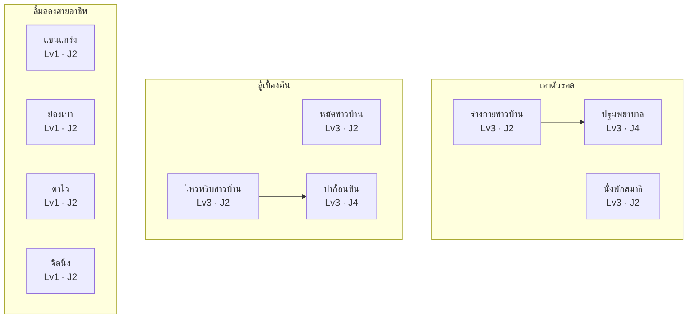
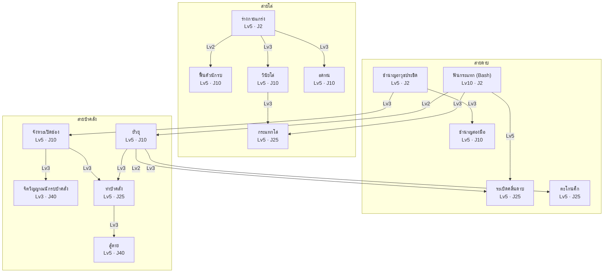
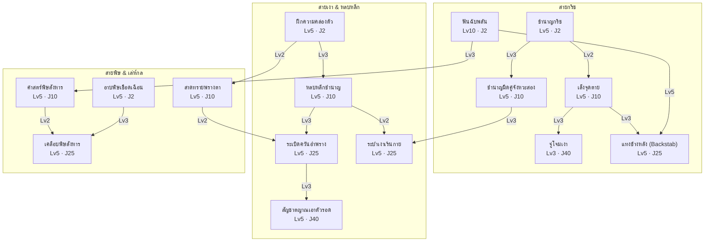
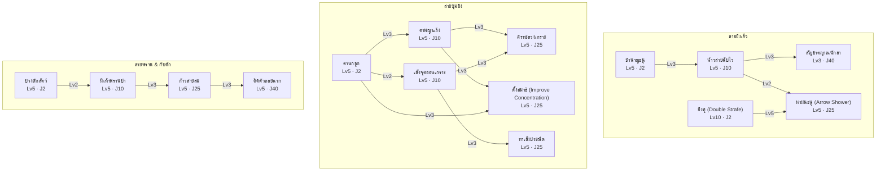
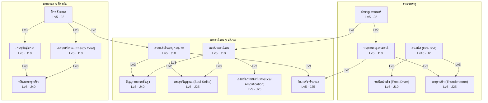

# ตารางสกิลและข้อมูลอ้างอิง (สร้างอัตโนมัติ)

> ไฟล์นี้สร้างจาก `skill-lab/src/01-defaults.js` ด้วย `node skill-lab/tools/gen-skill-tables.js` — **อย่าแก้มือ** ให้แก้ข้อมูลแล้วรันใหม่

หน่วย: SP/ค่าแบน เป็นตัวเลขตรง ๆ · `HP x%` = เศษส่วนของ HP สูงสุด · `a + b/Lv` = ค่าที่ Lv1 บวกเพิ่มต่อเลเวล · `c×Lv` = ต่อเลเวลเท่ากันทุกเลเวล · `[...]` = ตารางระบุทุกเลเวล

## ชาวบ้าน (Novice) (`novice`)

- คลาสแม่: — (คลาสเริ่มต้น) · Job Lv สูงสุด 10 · แต้มสกิลต่อ Job Lv 1
- สกิล 10 ตัว (passive 8 · active 2 · buff 0 · toggle 0 · trigger 0) รวม **22 เลเวล** เทียบแต้มที่ได้ **9** (ซื้อได้ 41%) → ต้องเลือกสร้างบิลด์

| รหัส | ชื่อ | ชนิด | สาย | Tier | Job Lv | Max | เงื่อนไขก่อนเรียน | อาวุธ | การใช้งาน | ผล (Lv1 → สูงสุด) |
|---|---|---|---|---|---|---|---|---|---|---|
| `nvHardy` | ร่างกายชาวบ้าน | passive | เอาตัวรอด | 1 | 2 | 3 | — | — | — | HP สูงสุด +3% → +9% |
| `nvRest` | นั่งพักสมาธิ | passive | เอาตัวรอด | 1 | 2 | 3 | — | — | — | HP regen/วิ +0.05 → +0.15<br>SP สูงสุด +3% → +9% |
| `nvScrapper` | หมัดชาวบ้าน | passive | สู้เบื้องต้น | 1 | 2 | 3 | — | ยกเว้น staff | — | ATK +2 → +6 |
| `nvWits` | ไหวพริบชาวบ้าน | passive | สู้เบื้องต้น | 1 | 2 | 3 | — | — | — | HIT +1 → +3<br>FLEE +1 → +3 |
| `nvStrongArms` | แขนแกร่ง | passive | ลิ้มลองสายอาชีพ | 1 | 2 | 1 | — | — | — | ATK +2 |
| `nvLightSteps` | ย่องเบา | passive | ลิ้มลองสายอาชีพ | 1 | 2 | 1 | — | — | — | ASPD +1 |
| `nvSharpEyes` | ตาไว | passive | ลิ้มลองสายอาชีพ | 1 | 2 | 1 | — | — | — | HIT +1.5 |
| `nvCalmMind` | จิตนิ่ง | passive | ลิ้มลองสายอาชีพ | 1 | 2 | 1 | — | — | — | MATK +1.5% |
| `nvFirstAid` | ปฐมพยาบาล | active | เอาตัวรอด | 2 | 4 | 3 | ร่างกายชาวบ้าน Lv1 | — | SP 5 · CD 15s | ฟื้น HP 2% + 1%/Lv ของสูงสุด |
| `nvStone` | ปาก้อนหิน | active | สู้เบื้องต้น | 2 | 4 | 3 | ไหวพริบชาวบ้าน Lv1 | — | SP 3 · CD 2s | กายภาพ (60% + 12%/Lv) DEX + (20% + 4%/Lv) STR |

### แผนผังการเชื่อมต่อ (Mermaid)



## นักดาบ (`swordman`)

- คลาสแม่: `novice` · Job Lv สูงสุด 50 · แต้มสกิลต่อ Job Lv 1
- สกิล 15 ตัว (passive 7 · active 4 · buff 2 · toggle 1 · trigger 1) รวม **78 เลเวล** เทียบแต้มที่ได้ **49** (ซื้อได้ 63%) → ต้องเลือกสร้างบิลด์

| รหัส | ชื่อ | ชนิด | สาย | Tier | Job Lv | Max | เงื่อนไขก่อนเรียน | อาวุธ | การใช้งาน | ผล (Lv1 → สูงสุด) |
|---|---|---|---|---|---|---|---|---|---|---|
| `swMastery` | ชำนาญอาวุธประชิด | passive | สายดาบ | 1 | 2 | 5 | — | ยกเว้น staff | — | ATK +5 → +25 |
| `swToughness` | ร่างกายแกร่ง | passive | สายโล่ | 1 | 2 | 5 | — | — | — | DEF +2 → +10 |
| `swBash` | ฟันกระแทก (Bash) | active | สายดาบ | 1 | 2 | 10 | — | — | SP [6, 6, 7, 7, 8, 8, 9, 9, 10, 10] · CD 3s | กายภาพ (130% + 30%/Lv) ATK |
| `swRecovery` | ฟื้นตัวนักรบ | passive | สายโล่ | 2 | 10 | 5 | ร่างกายแกร่ง Lv2 | — | — | HP regen/วิ +0.15 → +0.75 |
| `swTwoHand` | ชำนาญสองมือ | passive | สายดาบ | 2 | 10 | 5 | ชำนาญอาวุธประชิด Lv3 | 2H | — | ASPD +3 → +15 |
| `swOpening` | จังหวะเปิดช่อง | passive | สายบ้าคลั่ง | 2 | 10 | 5 | ชำนาญอาวุธประชิด Lv3 | — | — | Phys Crit % +1% → +5% |
| `swShieldDisc` | วินัยโล่ | passive | สายโล่ | 2 | 10 | 5 | ร่างกายแกร่ง Lv3 | ต้องสวมโล่ | — | DEF +3 → +15<br>Block Chance +2% → +10% |
| `swProvoke` | ยั่วยุ | active | สายบ้าคลั่ง | 2 | 10 | 5 | ฟันกระแทก (Bash) Lv2 | — | SP 8 · CD 12s · นาน 20s | DEF −6% → −30% (เป้า)<br>ATK +4% → +20% (เป้า) |
| `swEndure` | อดทน | buff | สายโล่ | 2 | 10 | 5 | ร่างกายแกร่ง Lv3 | — | SP 12 · CD 45s · นาน 15s + 5s/Lv | ลดดาเมจกายภาพ +5% → +25%<br>MDEF +2 → +10 |
| `swMagnum` | ระเบิดคลื่นดาบ | active | สายดาบ | 3 | 25 | 5 | ฟันกระแทก (Bash) Lv5, ยั่วยุ Lv2 | — | SP 20 + 2/Lv · HP 4% · CD 6s · นาน 8s | กายภาพ (120% + 30%/Lv) ATK [AoE]<br>ATK +3% → +15% |
| `swShieldBash` | กระแทกโล่ | active | สายโล่ | 3 | 25 | 5 | วินัยโล่ Lv3, ฟันกระแทก (Bash) Lv3 | ต้องสวมโล่ | SP 12 + 1/Lv · CD 4s | กายภาพ 110% ATK + (80% + 30%/Lv) DEF |
| `swBattleCry` | ตะโกนศึก | buff | สายดาบ | 3 | 25 | 5 | ยั่วยุ Lv3 | — | SP 15 · CD 90s · นาน 30s | ATK +4% → +20%<br>HIT +4 → +20 |
| `swBerserk` | ท่าบ้าคลั่ง | toggle | สายบ้าคลั่ง | 3 | 25 | 5 | จังหวะเปิดช่อง Lv3, ยั่วยุ Lv3 | — | SP 10 · HP ไหล 0.3%/s · ปิดเองเมื่อ HP < 15% | ATK +6% → +30%<br>ดาเมจที่รับเพิ่ม +5% → +25% |
| `swSoul` | จิตวิญญาณนักรบบ้าคลั่ง | passive | สายบ้าคลั่ง | 4 | 40 | 3 | จังหวะเปิดช่อง Lv3 | ยกเว้น staff | — | ATK +9 → +27 |
| `swLastStand` | สู้ตาย | trigger | สายบ้าคลั่ง | 4 | 40 | 5 | ท่าบ้าคลั่ง Lv3 | — | trigger: HP ≤ 25% ปิดเมื่อ > 50% CD 90s | ATK +8% → +40% |

### แผนผังการเชื่อมต่อ (Mermaid)



## โจร (`thief`)

- คลาสแม่: `novice` · Job Lv สูงสุด 50 · แต้มสกิลต่อ Job Lv 1
- สกิล 15 ตัว (passive 7 · active 4 · buff 2 · toggle 1 · trigger 1) รวม **78 เลเวล** เทียบแต้มที่ได้ **49** (ซื้อได้ 63%) → ต้องเลือกสร้างบิลด์

| รหัส | ชื่อ | ชนิด | สาย | Tier | Job Lv | Max | เงื่อนไขก่อนเรียน | อาวุธ | การใช้งาน | ผล (Lv1 → สูงสุด) |
|---|---|---|---|---|---|---|---|---|---|---|
| `thMastery` | ชำนาญกริช | passive | สายกริช | 1 | 2 | 5 | — | ยกเว้น staff | — | ATK +3 → +15 |
| `thAgility` | ฝึกความคล่องตัว | passive | สายเงา & หลบหลีก | 1 | 2 | 5 | — | — | — | ASPD +1.5 → +7.5 |
| `thQuickStrike` | ฟันฉับพลัน | active | สายกริช | 1 | 2 | 10 | — | ยกเว้น staff/bow | SP [5, 5, 6, 6, 7, 7, 8, 8, 9, 9] · CD 2.5s | กายภาพ (130% + 25%/Lv) ATK |
| `thEnvenom` | อาบพิษเชือดเฉือน | active | สายพิษ & เล่ห์กล | 1 | 2 | 5 | — | ยกเว้น staff/bow | SP 8 + 1/Lv · CD 8s · นาน 16s | กายภาพ (130% + 20%/Lv) ATK<br>ดาเมจที่รับเพิ่ม +3% → +15% (เป้า)<br>DEF −4% → −20% (เป้า) |
| `thEvasion` | หลบหลีกชำนาญ | passive | สายเงา & หลบหลีก | 2 | 10 | 5 | ฝึกความคล่องตัว Lv3 | — | — | FLEE +4 → +20 |
| `thDouble` | ชำนาญมีดคู่จังหวะสอง | passive | สายกริช | 2 | 10 | 5 | ชำนาญกริช Lv3 | เฉพาะ dagger | — | ASPD +1.5 → +7.5<br>HIT +2 → +10 |
| `thWeakSpot` | เล็งจุดตาย | passive | สายกริช | 2 | 10 | 5 | ชำนาญกริช Lv2 | — | — | Phys Crit % +1.5% → +7.5%<br>DEF Penetration +2% → +10% |
| `thVenomLore` | ศาสตร์พิษสังหาร | passive | สายพิษ & เล่ห์กล | 2 | 10 | 5 | ฟันฉับพลัน Lv3 | — | — | ATK +2% → +10%<br>SP regen/วิ +0.2 → +1 |
| `thSandAttack` | สาดทรายพรางตา | active | สายพิษ & เล่ห์กล | 2 | 10 | 5 | ฝึกความคล่องตัว Lv2 | — | SP 7 · CD 12s · นาน 18s | กายภาพ (110% + 15%/Lv) ATK<br>HIT −5 → −25 (เป้า)<br>FLEE −5 → −25 (เป้า) |
| `thBackstab` | แทงข้างหลัง (Backstab) | active | สายกริช | 3 | 25 | 5 | ฟันฉับพลัน Lv5, เล็งจุดตาย Lv3 | เฉพาะ dagger | SP 12 + 2/Lv · CD 4.5s | กายภาพ (200% + 35%/Lv) ATK + (50% + 15%/Lv) AGI |
| `thVenomCoat` | เคลือบพิษสังหาร | buff | สายพิษ & เล่ห์กล | 3 | 25 | 5 | อาบพิษเชือดเฉือน Lv3, ศาสตร์พิษสังหาร Lv2 | ยกเว้น staff/bow | SP 14 · CD 45s · นาน 30s | ATK +5% → +25%<br>DEF Penetration +3% → +15% |
| `thSmoke` | ระเบิดควันอำพราง | buff | สายเงา & หลบหลีก | 3 | 25 | 5 | หลบหลีกชำนาญ Lv3, สาดทรายพรางตา Lv2 | — | SP 15 · CD 40s · นาน 12s + 2s/Lv | FLEE +8 → +40<br>ลดดาเมจกายภาพ +4% → +20% |
| `thShadowDance` | ระบำเงาเร้นกาย | toggle | สายเงา & หลบหลีก | 3 | 25 | 5 | ชำนาญมีดคู่จังหวะสอง Lv3, หลบหลีกชำนาญ Lv2 | — | SP 8 · SP ไหล 0.6/s · ปิดเองเมื่อ HP < 10% | ASPD +2 → +10<br>Phys Crit % +2% → +10% |
| `thShadowStrike` | จู่โจมเงา | passive | สายกริช | 4 | 40 | 3 | เล็งจุดตาย Lv3 | ยกเว้น staff | — | Phys Crit % +3% → +9%<br>ATK +4 → +12 |
| `thCheatDeath` | สัญชาตญาณเอาตัวรอด | trigger | สายเงา & หลบหลีก | 4 | 40 | 5 | ระเบิดควันอำพราง Lv3 | — | trigger: HP ≤ 30% ปิดเมื่อ > 60% CD 75s | FLEE +10 → +50<br>ลดดาเมจกายภาพ +5% → +25% |

### แผนผังการเชื่อมต่อ (Mermaid)



## นักธนู (`archer`)

- คลาสแม่: `novice` · Job Lv สูงสุด 50 · แต้มสกิลต่อ Job Lv 1
- สกิล 15 ตัว (passive 7 · active 4 · buff 2 · toggle 1 · trigger 1) รวม **78 เลเวล** เทียบแต้มที่ได้ **49** (ซื้อได้ 63%) → ต้องเลือกสร้างบิลด์

| รหัส | ชื่อ | ชนิด | สาย | Tier | Job Lv | Max | เงื่อนไขก่อนเรียน | อาวุธ | การใช้งาน | ผล (Lv1 → สูงสุด) |
|---|---|---|---|---|---|---|---|---|---|---|
| `arOwlEye` | ตานกฮูก | passive | สายซุ่มยิง | 1 | 2 | 5 | — | — | — | DEX +2 → +10<br>HIT +3 → +15 |
| `arBowMastery` | ชำนาญธนู | passive | สายยิงเร็ว | 1 | 2 | 5 | — | เฉพาะ bow | — | ATK +4 → +20 |
| `arDoubleStrafe` | ยิงคู่ (Double Strafe) | active | สายยิงเร็ว | 1 | 2 | 10 | — | เฉพาะ bow | SP [6, 6, 7, 7, 8, 8, 9, 9, 10, 10] · CD 2.6s | กายภาพ (145% + 25%/Lv) ATK |
| `arAnkleSnare` | บ่วงดักสัตว์ | active | สายพราน & กับดัก | 1 | 2 | 5 | — | — | SP 9 · CD 12s · นาน 16s | กายภาพ (70% + 20%/Lv) DEX [ไม่คริ]<br>FLEE −8 → −40 (เป้า)<br>DEF −5% → −25% (เป้า)<br>ดาเมจที่รับเพิ่ม +2% → +10% (เป้า) |
| `arVultureEye` | ตาพญาแร้ง | passive | สายซุ่มยิง | 2 | 10 | 5 | ตานกฮูก Lv3 | — | — | HIT +3 → +15<br>Phys Crit % +1.5% → +7.5% |
| `arRapidFire` | น้าวสายฉับไว | passive | สายยิงเร็ว | 2 | 10 | 5 | ชำนาญธนู Lv3 | เฉพาะ bow | — | ASPD +3 → +15 |
| `arVitalShot` | เล็งจุดอ่อนเกราะ | passive | สายซุ่มยิง | 2 | 10 | 5 | ตานกฮูก Lv2 | — | — | Phys Crit % +1.5% → +7.5%<br>DEF Penetration +3% → +15% |
| `arRangerStep` | ฝีเท้าพรานป่า | passive | สายพราน & กับดัก | 2 | 10 | 5 | บ่วงดักสัตว์ Lv2 | — | — | FLEE +3 → +15<br>SP regen/วิ +0.25 → +1.25 |
| `arArrowShower` | ห่าฝนธนู (Arrow Shower) | active | สายยิงเร็ว | 3 | 25 | 5 | ยิงคู่ (Double Strafe) Lv5, น้าวสายฉับไว Lv2 | เฉพาะ bow | SP 12 + 2/Lv · CD 4s | กายภาพ (140% + 30%/Lv) ATK [AoE] |
| `arPiercingShot` | ศรทะลวงเกราะ | active | สายซุ่มยิง | 3 | 25 | 5 | ตาพญาแร้ง Lv3, เล็งจุดอ่อนเกราะ Lv3 | เฉพาะ bow | SP 12 + 2/Lv · CD 5.5s · นาน 10s | กายภาพ (180% + 30%/Lv) ATK + (60% + 15%/Lv) DEX<br>DEF −5% → −25% (เป้า) |
| `arConcentrate` | ตั้งสมาธิ (Improve Concentration) | buff | สายซุ่มยิง | 3 | 25 | 5 | ตาพญาแร้ง Lv3, ตานกฮูก Lv3 | — | SP 16 · CD 60s · นาน 35s | ATK +4% → +20%<br>HIT +5 → +25<br>DEX +3 → +15 |
| `arWindWalk` | ก้าวสายลม | buff | สายพราน & กับดัก | 3 | 25 | 5 | ฝีเท้าพรานป่า Lv3 | — | SP 14 · CD 45s · นาน 30s | FLEE +6 → +30<br>ASPD +2.5 → +12.5<br>ATK +3% → +15% |
| `arSniperStance` | ท่าเล็งประณีต | toggle | สายซุ่มยิง | 3 | 25 | 5 | เล็งจุดอ่อนเกราะ Lv3 | — | SP 10 · SP ไหล 0.6/s · ปิดเองเมื่อ HP < 15% | ATK +5% → +25%<br>Phys Crit % +2.5% → +12.5% |
| `arHunterInstinct` | สัญชาตญาณนักล่า | passive | สายยิงเร็ว | 4 | 40 | 3 | น้าวสายฉับไว Lv3 | ยกเว้น staff | — | ATK +8 → +24<br>Phys Crit % +2% → +6% |
| `arEvasiveRoll` | ดีดตัวถอยฉาก | trigger | สายพราน & กับดัก | 4 | 40 | 5 | ก้าวสายลม Lv3 | — | trigger: HP ≤ 35% ปิดเมื่อ > 65% CD 60s | FLEE +12 → +60<br>ลดดาเมจกายภาพ +5% → +25% |

### แผนผังการเชื่อมต่อ (Mermaid)



## จอมเวท (`mage`)

- คลาสแม่: `novice` · Job Lv สูงสุด 50 · แต้มสกิลต่อ Job Lv 1
- สกิล 15 ตัว (passive 7 · active 4 · buff 2 · toggle 1 · trigger 1) รวม **78 เลเวล** เทียบแต้มที่ได้ **49** (ซื้อได้ 63%) → ต้องเลือกสร้างบิลด์

| รหัส | ชื่อ | ชนิด | สาย | Tier | Job Lv | Max | เงื่อนไขก่อนเรียน | อาวุธ | การใช้งาน | ผล (Lv1 → สูงสุด) |
|---|---|---|---|---|---|---|---|---|---|---|
| `mgSpellMastery` | ชำนาญเวทมนตร์ | passive | สายเวทธาตุ | 1 | 2 | 5 | — | — | — | MATK +2.5% → +12.5% |
| `mgManaTraining` | ฝึกพลังมานา | passive | สายมานา & ป้องกัน | 1 | 2 | 5 | — | — | — | SP สูงสุด +4% → +20%<br>SP regen/วิ +0.35 → +1.75 |
| `mgFireBolt` | ศรเพลิง (Fire Bolt) | active | สายเวทธาตุ | 1 | 2 | 10 | — | — | SP [10, 11, 12, 13, 14, 15, 16, 18, 20, 22] · CD 3s | เวท (110% + 20%/Lv) MATK |
| `mgArcaneFocus` | สมาธิเวทอาร์เคน | passive | สายอาร์เคน & คริเวท | 2 | 10 | 5 | ชำนาญเวทมนตร์ Lv3 | — | — | Magic Crit % +1.5% → +7.5% |
| `mgInsight` | ความเข้าใจทะลุเกราะเวท | passive | สายอาร์เคน & คริเวท | 2 | 10 | 5 | ฝึกพลังมานา Lv2 | — | — | MDEF Ignore (คริเวท) +3% → +15% |
| `mgElemMastery` | ประสานธาตุธรรมชาติ | passive | สายเวทธาตุ | 2 | 10 | 5 | ชำนาญเวทมนตร์ Lv2 | — | — | MATK +4 → +20<br>INT +2 → +10 |
| `mgMindWard` | เกราะจิตคุ้มกาย | passive | สายมานา & ป้องกัน | 2 | 10 | 5 | ฝึกพลังมานา Lv3 | — | — | MDEF +4 → +20<br>HP สูงสุด +3% → +15% |
| `mgFrostNova` | ระเบิดน้ำแข็ง (Frost Diver) | active | สายเวทธาตุ | 2 | 10 | 5 | ศรเพลิง (Fire Bolt) Lv3 | — | SP 12 + 2/Lv · CD 10s · นาน 16s | เวท (100% + 15%/Lv) MATK<br>MDEF −7% → −35% (เป้า)<br>ATK −3% → −15% (เป้า) |
| `mgEnergyCoat` | เกราะพลังงาน (Energy Coat) | buff | สายมานา & ป้องกัน | 2 | 10 | 5 | ฝึกพลังมานา Lv3 | — | SP 20 · CD 45s · นาน 20s + 5s/Lv | ลดดาเมจกายภาพ +6% → +30%<br>MDEF +4 → +20 |
| `mgThunderStorm` | พายุสายฟ้า (Thunderstorm) | active | สายเวทธาตุ | 3 | 25 | 5 | ศรเพลิง (Fire Bolt) Lv5, ประสานธาตุธรรมชาติ Lv3 | — | SP 22 + 3/Lv · CD 5.5s | เวท (125% + 22%/Lv) MATK [AoE] |
| `mgSoulStrike` | กระสุนวิญญาณ (Soul Strike) | active | สายอาร์เคน & คริเวท | 3 | 25 | 5 | สมาธิเวทอาร์เคน Lv3, ความเข้าใจทะลุเกราะเวท Lv2 | — | SP 12 + 2/Lv · CD 2.6s · นาน 10s | เวท (140% + 25%/Lv) MATK + (80% + 20%/Lv) INT<br>MDEF −5% → −25% (เป้า) |
| `mgAmplify` | เร่งพลังเวทมนตร์ (Mystical Amplification) | buff | สายอาร์เคน & คริเวท | 3 | 25 | 5 | สมาธิเวทอาร์เคน Lv3 | — | SP 20 · CD 50s · นาน 30s | MATK +5% → +25%<br>Magic Crit % +2% → +10% |
| `mgOvercharge` | โอเวอร์ชาร์จมานา | toggle | สายอาร์เคน & คริเวท | 3 | 25 | 5 | ความเข้าใจทะลุเกราะเวท Lv3, ประสานธาตุธรรมชาติ Lv2 | — | SP 12 · SP ไหล 1.2/s · ปิดเองเมื่อ HP < 15% | MATK +6% → +30%<br>Crit Dmg Bonus (เวท) +4% → +20% |
| `mgArchmageWisdom` | ปัญญาจอมเวทชั้นสูง | passive | สายอาร์เคน & คริเวท | 4 | 40 | 3 | สมาธิเวทอาร์เคน Lv3, ความเข้าใจทะลุเกราะเวท Lv3 | — | — | Crit Dmg Bonus (เวท) +5% → +15%<br>MATK +4% → +12% |
| `mgManaSurge` | คลื่นมานาฉุกเฉิน | trigger | สายมานา & ป้องกัน | 4 | 40 | 5 | เกราะพลังงาน (Energy Coat) Lv3, เกราะจิตคุ้มกาย Lv3 | — | trigger: HP ≤ 35% ปิดเมื่อ > 70% CD 60s | SP regen/วิ +1.5 → +7.5<br>ลดดาเมจกายภาพ +5% → +25%<br>HP regen/วิ +0.5 → +2.5 |

### แผนผังการเชื่อมต่อ (Mermaid)



## อาวุธ (`weapons`)

| รหัส | ชื่อ | การถือ | ประเภทดาเมจ | weaponClass |
|---|---|---|---|---|
| `unarmed` | มือเปล่า | 1H | blunt | unarmed |
| `sword_1h` | ดาบ 1 มือ | 1H | slash | sword |
| `sword_2h` | ดาบ 2 มือ | 2H | slash | sword |
| `axe` | ขวาน | 1H | slash | axe |
| `mace` | กระบอง | 1H | blunt | mace |
| `dagger` | กริช | 1H | pierce | dagger |
| `bow` | ธนู | 2H | pierce | bow |
| `staff` | ไม้เท้า | 2H | magic | staff |

## นิยามสเตตัส (`statDefs`)

| รหัส | ชื่อ | กลุ่ม | kind | ความหมายของ kind |
|---|---|---|---|---|
| `str` | STR | สเตตัสหลัก | num | ตัวเลขปกติ |
| `agi` | AGI | สเตตัสหลัก | num | ตัวเลขปกติ |
| `vit` | VIT | สเตตัสหลัก | num | ตัวเลขปกติ |
| `int` | INT | สเตตัสหลัก | num | ตัวเลขปกติ |
| `dex` | DEX | สเตตัสหลัก | num | ตัวเลขปกติ |
| `luk` | LUK | สเตตัสหลัก | num | ตัวเลขปกติ |
| `atk` | ATK | โจมตี | num | ตัวเลขปกติ |
| `matk` | MATK | โจมตี | num | ตัวเลขปกติ |
| `hit` | HIT | โจมตี | num | ตัวเลขปกติ |
| `aspd` | ASPD | โจมตี | num | ตัวเลขปกติ |
| `physCrit` | Phys Crit % | โจมตี | pct | หน่วยเป็น % อยู่แล้ว (7 = 7%) |
| `magicCrit` | Magic Crit % | โจมตี | pct | หน่วยเป็น % อยู่แล้ว (7 = 7%) |
| `mdefIgnore` | MDEF Ignore (คริเวท) | โจมตี | frac | เศษส่วน (0.05 = 5%) |
| `critDmg` | Crit Dmg Bonus (เวท) | โจมตี | frac | เศษส่วน (0.05 = 5%) |
| `defPen` | DEF Penetration | โจมตี | frac | เศษส่วน (0.05 = 5%) |
| `def` | DEF | ป้องกัน | num | ตัวเลขปกติ |
| `mdef` | MDEF | ป้องกัน | num | ตัวเลขปกติ |
| `flee` | FLEE | ป้องกัน | num | ตัวเลขปกติ |
| `blockChance` | Block Chance | ป้องกัน | frac | เศษส่วน (0.05 = 5%) |
| `physReduction` | ลดดาเมจกายภาพ | ป้องกัน | frac | เศษส่วน (0.05 = 5%) |
| `damageTaken` | ดาเมจที่รับเพิ่ม | ป้องกัน | frac | เศษส่วน (0.05 = 5%) |
| `maxHp` | HP สูงสุด | ทรัพยากร | num | ตัวเลขปกติ |
| `maxSp` | SP สูงสุด | ทรัพยากร | num | ตัวเลขปกติ |
| `hpRegen` | HP regen/วิ | ทรัพยากร | num | ตัวเลขปกติ |
| `spRegen` | SP regen/วิ | ทรัพยากร | num | ตัวเลขปกติ |

## ชุดสเตตัสสำเร็จรูป (`presets`)

| รหัส | ชื่อ | อาวุธ | โล่ | ATK | ASPD | HIT | FLEE | DEF | MDEF | HP | SP |
|---|---|---|---|---|---|---|---|---|---|---|---|
| `sw50_1h` | นักดาบ Lv50 · ดาบ 1 มือ | sword_1h | — | 40 | 120 | 90 | 88 | 14.4 | 15 | 1904 | 384 |
| `sw50_shield` | นักดาบ Lv50 · ดาบ+โล่ | sword_1h | ใช่ | 40 | 115 | 90 | 88 | 29 | 15 | 1904 | 384 |
| `sw50_2h` | นักดาบ Lv50 · ดาบ 2 มือ | sword_2h | — | 56 | 105 | 90 | 88 | 14.8 | 15 | 1904 | 384 |
| `th50_dagger` | โจร Lv50 · กริช | dagger | — | 45.5 | 132 | 85 | 100.5 | 10 | 10 | 1364 | 504 |
| `ar50_bow` | นักธนู Lv50 · ธนู | bow | — | 50 | 128 | 115 | 95 | 10 | 10 | 1240 | 560 |
| `mg50_staff` | จอมเวท Lv50 · ไม้เท้า | staff | — | 1 | 114 | 90 | 80.5 | 10 | 25 | 744 | 1120 |
| `novice10` | ชาวบ้าน Lv10 · มือเปล่า | unarmed | — | 5 | 103 | 60 | 58 | 4 | 2.5 | 296 | 120 |

## มอนสเตอร์ทดสอบ (`monsters`)

| รหัส | ชื่อ | DEF | MDEF | FLEE | HP | ATK | HIT | ตีทุก (วิ) |
|---|---|---|---|---|---|---|---|---|
| `dummy` | ดัมมี่ธรรมดา | 40 | 30 | 60 | 20000 | 80 | 100 | 2 |
| `armor` | หุ่นเกราะหนา | 200 | 60 | 30 | 40000 | 150 | 110 | 2.5 |
| `boss` | บอสทดสอบ | 400 | 150 | 80 | 150000 | 400 | 140 | 1.8 |

## บิลด์ตัวอย่าง (`builds`)

| รหัส | ชื่อ | คลาส | Job Lv | พรีเซ็ต | สกิลที่ลง |
|---|---|---|---|---|---|
| `bld_striker` | นักดาบสองมือ (Striker) | swordman | 50 | sw50_2h | nvScrapper:3, nvHardy:3, nvStrongArms:1, nvWits:2, swMastery:5, swTwoHand:5, swOpening:5, swBash:10, swProvoke:3, swMagnum:5, swBattleCry:5, swSoul:3, swBerserk:5, swLastStand:3 |
| `bld_guardian` | ดาบ+โล่ (Guardian) | swordman | 50 | sw50_shield | nvHardy:3, nvRest:3, nvFirstAid:3, swToughness:5, swRecovery:5, swShieldDisc:5, swEndure:5, swBash:9, swShieldBash:5, swProvoke:5, swMastery:5, swBattleCry:5 |
| `bld_berserker` | บ้าคลั่ง (Berserker) | swordman | 50 | sw50_1h | nvScrapper:3, nvHardy:3, nvStrongArms:1, nvWits:2, swMastery:5, swOpening:5, swBash:8, swProvoke:3, swBerserk:5, swLastStand:5, swSoul:3, swToughness:5, swRecovery:5, swEndure:5 |
| `bld_th_assassin` | โจรสายกริชลอบสังหาร (Assassin) | thief | 50 | th50_dagger | nvWits:3, nvScrapper:3, nvLightSteps:1, nvHardy:2, thMastery:5, thDouble:5, thWeakSpot:5, thShadowStrike:3, thQuickStrike:10, thBackstab:5, thAgility:3, thEvasion:3, thShadowDance:5, thEnvenom:5 |
| `bld_th_venom` | โจรสายพิษ & เงา (Venom Phantom) | thief | 50 | th50_dagger | nvWits:3, nvScrapper:3, nvLightSteps:1, nvHardy:2, thMastery:5, thQuickStrike:6, thEnvenom:5, thVenomLore:5, thVenomCoat:5, thAgility:5, thEvasion:5, thSandAttack:3, thSmoke:5, thCheatDeath:5 |
| `bld_ar_sharpshooter` | นักธนูสายยิงเร็ว & คริ (Sharpshooter) | archer | 50 | ar50_bow | nvWits:3, nvHardy:3, nvRest:2, nvSharpEyes:1, arBowMastery:5, arRapidFire:5, arHunterInstinct:3, arDoubleStrafe:10, arOwlEye:5, arVultureEye:5, arVitalShot:5, arPiercingShot:5, arConcentrate:5, arSniperStance:1 |
| `bld_ar_ranger` | นักธนูสายพราน & ห่าฝนธนู (Ranger) | archer | 50 | ar50_bow | nvWits:3, nvHardy:3, nvRest:2, nvSharpEyes:1, arBowMastery:5, arRapidFire:5, arDoubleStrafe:9, arArrowShower:5, arAnkleSnare:5, arRangerStep:5, arWindWalk:5, arEvasiveRoll:5, arOwlEye:5 |
| `bld_mg_elementalist` | จอมเวทสายธาตุทำลายล้าง (Elementalist) | mage | 50 | mg50_staff | nvRest:3, nvHardy:3, nvFirstAid:2, nvCalmMind:1, mgSpellMastery:5, mgElemMastery:5, mgFireBolt:10, mgFrostNova:5, mgThunderStorm:5, mgManaTraining:5, mgEnergyCoat:5, mgArcaneFocus:4, mgAmplify:5 |
| `bld_mg_arcanist` | จอมเวทสายคริอาร์เคน (Arcanist) | mage | 50 | mg50_staff | nvRest:3, nvHardy:3, nvFirstAid:2, nvCalmMind:1, mgSpellMastery:3, mgElemMastery:2, mgFireBolt:6, mgArcaneFocus:5, mgInsight:5, mgArchmageWisdom:3, mgSoulStrike:5, mgAmplify:5, mgOvercharge:5, mgManaTraining:5, mgEnergyCoat:5 |
| `bld_nv_survivor` | ชาวบ้านสายทน | novice | 10 | novice10 | nvHardy:3, nvRest:3, nvFirstAid:3 |
| `bld_nv_skirmisher` | ชาวบ้านสายปาหิน | novice | 10 | novice10 | nvWits:3, nvStone:3, nvSharpEyes:1, nvLightSteps:1, nvRest:1 |

## ค่ากลาง (`globals`)

```json
{
  "aspdCap": 193,
  "softDefK": 300,
  "maxPhysReduction": 0.8,
  "maxMagicReduction": 0.8,
  "maxDodge": 0.6,
  "critMult": 1.5,
  "blockReduction": 0.3,
  "hitBase": 0.5,
  "hitPerPoint": 0.01,
  "respawnDelay": 1.2,
  "reviveDelay": 2,
  "buffPercentCap": {
    "atk": 0.6,
    "matk": 0.6
  }
}
```
